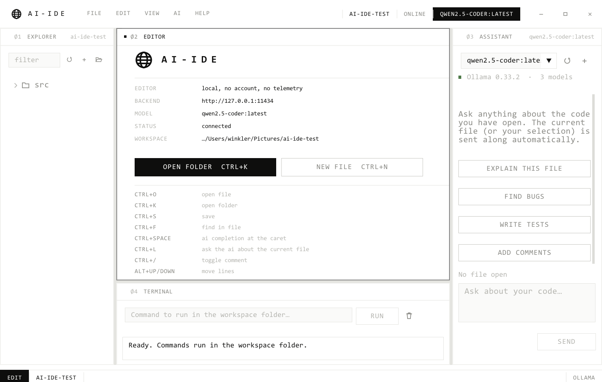

# Cortex

A local code editor written entirely in C++ that talks to your own models through
[Ollama](https://ollama.com). No cloud service, no account, no telemetry — the editor
runs on your machine and the model runs on your machine. It runs on Windows and macOS
(and builds on Linux).

**Download:** the [latest release](https://github.com/999david7/Cortex/releases) has a
`.dmg` for macOS 11+ (Apple silicon and Intel) and a `.zip` with the Windows `.exe`.



---

## What it does

**Editor**
- Code editor written from scratch on top of Dear ImGui draw lists
- Syntax highlighting for ~90 languages (C/C++, C#, Java, Kotlin, Swift, Go, Rust,
  Zig, Python, Ruby, PHP, JS/TS/JSX/TSX, Svelte, Vue, Haskell, OCaml, F#, Elixir,
  Erlang, Clojure, Lua, R, Julia, SQL, GraphQL, Protobuf, HTML/CSS/SCSS, YAML,
  TOML, Terraform, Nix, Dockerfile, Makefile, CMake, Assembly, Fortran, …)
- Every language has its own file mark in the tree and on the tab: a hairline
  square carrying its short code, with the language's colour as a rule along
  the bottom edge
- Source colours for paper — ink for identifiers, brick for keywords, ochre for
  literals, grey for everything structural

**Look**
- Editorial rather than app-like: paper white, ink black, hairline rules, square
  corners everywhere and a 1px frame on every pane
- Nothing is filled unless it is *active* — the open file, the selected model and
  the editor mode are solid black with their type knocked out white, and
  everything else sits on the paper
- Every label in the chrome is small, uppercase and widely tracked; the panes are
  numbered `Ø1 EXPLORER`, `Ø2 EDITOR`, `Ø3 ASSISTANT`, `Ø4 TERMINAL`, and the
  focused one is marked with a filled square and an ink frame
- Open files sit in a rail of numbered cells that carry the index and language
  above the name
- Monospace throughout, chrome included, so everything sits on one character grid
- Beyond the ink there are two hues in the whole interface, and they only ever
  mark data: ochre for a warning, brick for an error
- Line numbers, current-line highlight, indent guides, multi-line selection
- Undo/redo with typing coalescing, auto-indent, bracket and quote auto-closing
- Tabbed documents with a modified marker, drag-and-drop file opening; every
  tab keeps its own scroll position

**Cursors** (the VS Code set)
- Six caret shapes — line, block, underline, thin line, block outline and thin
  underline — and five blink animations: blink, smooth, phase, expand and
  solid. A block caret knocks the character under it out in paper white
- Caret width for the line shape, an optional smooth caret animation, and a
  separate shape for overtype mode (`Insert`), which shows `OVR` in the status bar
- Settings → Editor has a live sample of every shape; click one to choose it.
  The same choices are in *View → Cursor* and the command palette
- The pointer is an I-beam over the text
- Multiple cursors: `Alt+Click` adds or removes one, `Ctrl+Alt+Up/Down` adds
  one above or below, `Ctrl+D` adds the next occurrence, `Ctrl+Shift+L` selects
  every occurrence, `Shift+Alt+I` puts one at the end of each selected line,
  `Shift+Alt+Drag` makes a column (box) selection, `Ctrl+U` undoes the last
  cursor change and `Escape` goes back to one
- Everything works at every cursor: typing, auto-closing, Enter with
  auto-indent, Backspace, word deletion, comments, indenting, moving and
  copying lines, case transforms. Typing at many cursors is still one undo step
- Pasting as many lines as there are cursors puts one line at each; copying
  with nothing selected copies the line, and pasting it back inserts it as a
  line above, as VS Code does

**Editing tools**
- Find and replace (`Ctrl+F` / `Ctrl+H`) with match case, whole word and
  regular expressions (`$1` groups and `\n` in the replacement), `F3` /
  `Shift+F3` to step, and find matches marked on the minimap
- Find in files (`Ctrl+Shift+F`): a search view beside the file tree that walks
  the folder on a background thread, groups hits by file and opens the match
  on click
- Line commands: delete line, insert line above/below, move and copy lines,
  indent/outdent, join lines, toggle line and block comments
- Sort lines ascending/descending, reverse lines, delete duplicate lines, trim
  trailing whitespace, transpose characters, convert indentation to tabs or spaces
- Transform to upper, lower, title, snake, camel, Pascal and kebab case
- Expand/shrink selection (word → string → bracket contents → brackets → line →
  file), select to bracket, jump to the matching bracket
- Matching bracket highlight (strings and comments do not count), optional
  bracket pair colours, highlight of the word under the caret elsewhere in view
- Minimap with a draggable view slider, rulers at any columns, rendered
  whitespace (none, boundary, selection, trailing or all)
- `Ctrl+Backspace` / `Ctrl+Delete` delete by word, `Ctrl+Up/Down` scroll a line
- Editor font zoom: `Ctrl+=`, `Ctrl+-`, `Ctrl+0` or `Ctrl+wheel`

**AI (any Ollama model)**
- Model picker fed live from `/api/tags` — every model you have installed shows up,
  and a model in your settings that is no longer installed is reported and swapped
  for one that is, rather than failing every message
- Streaming chat: tokens appear as they are generated, with a Stop button
- The open file (or just your selection) is attached to each message automatically
- Markdown rendering with headings, lists, inline code and syntax-highlighted code
  blocks, each with **Copy** and **Insert into editor** buttons
- Reasoning models: `thinking` output is captured and shown in a collapsible section
- One-click actions: Explain, Improve, Fix, Write tests
- The model works on the project directly through tools: `read_file`,
  `list_directory`, `search_files`, `edit_file`, `create_file`, `create_directory`.
  Writes are shown as a card with a preview and wait for approval; reads run
  immediately. Every result — including failures — is fed back to the model, so it
  can correct itself instead of inventing an outcome.
- `edit_file` replaces an exact snippet rather than rewriting a whole file, which
  is what makes edits practical for small local models
- Guard rails around what a small model gets wrong when it builds something new:
  a text tool cannot create a `.jpg`, `.png`, `.woff` or any other binary asset,
  so that call is refused with a note to draw in SVG or CSS instead — which is
  what stops a generated site from arriving full of 15-byte "images"
- Every page the model writes is checked against the files it references: a
  missing stylesheet, script, image or linked page comes straight back in the
  tool result, so the model fixes the dead link in the same turn instead of
  reporting success over a broken site
- The transcript is compacted when it approaches the context window, so a long
  build does not silently push its own instructions out of the model's memory
- File work runs at its own low sampling temperature (Settings → Model), because
  the sampling that makes prose readable is what makes a small model drift off
  the instructions it was just given
- The system prompt carries a map of the project, so the model knows what exists
  before it starts guessing
- Inline completion at the caret (`Ctrl+Space`) shown as ghost text, `Tab` accepts
- Tokens/second and token count reported per reply

**Live preview**
- A local web server for the open folder, in the shape of VS Code's Live Server:
  `Alt+L`, the **Go live** button over the editor, or *View → Go Live*
- Serves the current page at `http://127.0.0.1:5500/...` and opens the browser on
  it; any other kind of file opens the site root
- Live reload: a small script is woven into every HTML page the server sends, the
  folder is watched with `ReadDirectoryChangesW`, and the open tab reloads itself
  as soon as a file changes — from the editor or from anywhere else
- `index.html` resolution per directory, a directory listing where there is none,
  correct MIME types, byte ranges (so `<video>` can seek) and no-store caching so
  a reload never shows the previous version
- Bound to `127.0.0.1` only, so the folder is reachable from this machine and
  nowhere else, and the server refuses any path that resolves outside the root.
  A busy port moves up to the next free one
- Port and auto-reload live in *Settings → Preview*; the status bar shows
  `LIVE <port>` while it runs

**Workspace**
- Command palette (`Ctrl+Shift+P` or `F1`) with every command and its
  shortcut, fuzzy matched, recently used ones first
- Quick open (`Ctrl+P`, or the box in the middle of the title bar): fuzzy file
  search over the whole folder. In the same box `>` runs a command, `:` goes to
  a line (`:120:8` for a column too) and `@` goes to a symbol in the open file
- File tree with type-colored icons, lazy directory loading and a filter box
- Menus in VS Code's order — File, Edit, Selection, View, Go, AI, Help — that
  drop down from their names and follow the pointer once one is open
- Tab context menu (close, close others, close to the right, close saved,
  copy path, reveal), middle-click to close, `Ctrl+Tab` / `Ctrl+PageDown` to
  cycle and `Ctrl+Shift+T` to reopen a closed tab; save all and revert file
- Clickable status bar: language mode, line endings (LF/CRLF), indentation and
  `Ln, Col` (go to line) each open a picker; cursor and selection counts show
  next to them
- Integrated terminal panel: run build/test commands in the workspace folder,
  output streamed live
- Dockable, rearrangeable panels; the layout is remembered between sessions
- Custom frameless window with a native feel (snap, resize, rounded Win11 corners)

---

## Installing on macOS

1. Download `Cortex-<version>.dmg` from the
   [releases page](https://github.com/999david7/Cortex/releases), open it and drag
   **Cortex** onto **Applications**.
2. The app is not notarized, so macOS blocks the first launch. Open it once, close
   the warning, then go to **System Settings → Privacy & Security** and click
   **Open Anyway** (on macOS 14 and earlier: Control-click the app → **Open**).
   From Terminal, `xattr -dr com.apple.quarantine /Applications/Cortex.app` does
   the same.
3. Install [Ollama for Mac](https://ollama.com) and pull a model.

On a Mac every `Ctrl` shortcut below is `Cmd`, and `Alt` is `Option`; the menus
and the command palette show the Mac keys. The usual Mac editing keys work too:
`Cmd+Left/Right` to the line ends, `Option+Left/Right` by word, `Option+Backspace`
to delete a word, and `Cmd+Option+F` for replace (`Cmd+H` hides the app).

Settings live in `~/Library/Application Support/AI IDE/`.

---

## Requirements (Windows)

- Windows 10 or 11, 64-bit
- [Ollama](https://ollama.com) running locally with at least one model pulled:
  ```bash
  ollama pull qwen2.5-coder
  ```
- A C++17 compiler: [w64devkit](https://github.com/skeeto/w64devkit/releases)
  extracted to `tools\w64devkit` (so `tools\w64devkit\bin\g++.exe` exists), or any
  MinGW-w64 `g++` on `PATH`. See [`tools/README.md`](tools/README.md).

No other dependencies. Dear ImGui is vendored in `vendor/imgui`; everything else is
the Windows SDK (Direct3D 11, WinHTTP, DWM, COM).

---

## Build

```bash
build.bat
```

That puts the local toolchain on `PATH` and runs `make`. The result is
`build\AI-IDE.exe`, a single self-contained executable (statically linked runtime, so
it also runs on machines without a compiler installed).

Other targets:

```bash
make DEBUG=1
```

```bash
make clean
```

> If the link step fails with a permission error, the IDE is still running — close it first.

### macOS and Linux

On a Mac, with the Xcode command line tools and GLFW (`brew install glfw`):

```bash
make            # build/cortex
make app        # build/Cortex.app
make dmg        # build/Cortex-<version>.dmg, the app next to an Applications link
```

`make dmg ARCHS="arm64 x86_64" GLFW_PREFIX=<static universal GLFW>` is how the
release is built: one binary for both kinds of Mac, with nothing to install. The
GitHub Actions workflow in `.github/workflows/build.yml` does exactly that on
every push, and publishes a release when a `v*` tag is pushed.

On Linux, with `libglfw3-dev` and `libcurl4-openssl-dev`, `make` builds
`build/cortex` (file dialogs use `zenity` when it is installed).

Editor tests:

```bash
make test
```

They drive the real editor widget through ImGui frames with simulated keys and
mouse — multiple cursors, line commands, find and replace, undo — and need no
window or GPU, so they also build with a plain `g++` on Linux or macOS.

---

## Run

```bash
build\AI-IDE.exe
```

A file or folder can be passed as an argument:

```bash
build\AI-IDE.exe src\app.cpp
```

The window renders through Direct3D, so no external screen grabber can capture
it. `--screenshot <path> [frames]` renders that many frames, writes the back
buffer to a BMP and exits:

```bash
build\AI-IDE.exe --screenshot shot.bmp 90
```

On first start, open a folder (`Ctrl+K`) and pick a model in the AI panel. If Ollama is
running, the status dot next to the model name is green and the model list fills itself.

`examples\demo.cpp` is a small playground file for trying the AI features.

---

## Keyboard shortcuts

`Help → Keyboard Shortcuts` lists them all in the app; the command palette shows
each command's shortcut beside it.

| Keys | Action |
| --- | --- |
| `Ctrl+Shift+P` / `F1` | Command palette |
| `Ctrl+P` | Go to file (`>` commands, `:` line, `@` symbol, `?` help) |
| `Ctrl+G` / `Ctrl+Shift+O` | Go to line / go to symbol in the file |
| `Ctrl+N` / `Ctrl+O` / `Ctrl+K` | New file / open file / open folder |
| `Ctrl+S` / `Ctrl+Shift+S` | Save / save as |
| `Ctrl+W` / `Ctrl+Shift+T` | Close tab / reopen the last closed tab |
| `Ctrl+Tab` / `Ctrl+Shift+Tab` | Next / previous tab (also `Ctrl+PageDown` / `Ctrl+PageUp`) |
| `Ctrl+F` / `Ctrl+H` | Find / replace (`Alt+C`, `Alt+W`, `Alt+R` toggle case, word, regex) |
| `F3` / `Shift+F3` | Next / previous match |
| `Ctrl+Shift+F` | Find in files |
| `Ctrl+Z` / `Ctrl+Y` | Undo / redo |
| `Alt+Click` | Add or remove a cursor |
| `Shift+Alt+Drag` | Column (box) selection |
| `Ctrl+Alt+Up` / `Ctrl+Alt+Down` | Add a cursor above / below |
| `Ctrl+D` | Add the next occurrence to the selection |
| `Ctrl+Shift+L` / `Ctrl+F2` | Select all occurrences |
| `Shift+Alt+I` | Cursors at the ends of the selected lines |
| `Ctrl+U` | Undo the last cursor change |
| `Escape` | Back to a single cursor |
| `Shift+Alt+Right` / `Shift+Alt+Left` | Expand / shrink selection |
| `Alt+Up` / `Alt+Down` | Move lines |
| `Shift+Alt+Up` / `Shift+Alt+Down` | Copy lines up / down |
| `Ctrl+Shift+K` | Delete line |
| `Ctrl+Enter` / `Ctrl+Shift+Enter` | Insert line below / above |
| `Ctrl+]` / `Ctrl+[` | Indent / outdent line |
| `Tab` / `Shift+Tab` | Indent / outdent selection |
| `Ctrl+/` / `Shift+Alt+A` | Toggle line comment / block comment |
| `Ctrl+Shift+\` | Go to matching bracket |
| `Ctrl+Backspace` / `Ctrl+Delete` | Delete word left / right |
| `Ctrl+Up` / `Ctrl+Down` | Scroll one line |
| `Insert` | Toggle overtype |
| `Ctrl+=` / `Ctrl+-` / `Ctrl+0` | Zoom the editor font in / out / reset |
| `Alt+L` | Go live: serve the folder and open the browser |
| `Ctrl+Space` | AI completion at the caret |
| `Tab` (on a suggestion) | Accept the AI suggestion |
| `Ctrl+L` | Send the file or selection to the chat |
| `Enter` / `Ctrl+Enter` | Send chat message / new line in the message |
| `Ctrl+,` | Settings |

`Ctrl+D` follows VS Code: it adds the next occurrence. Duplicating a line is
`Shift+Alt+Down` (copy line down), or *Selection → Duplicate Selection*.

---

## Settings

Everything is configurable from **File → Settings**: Ollama host, chat model,
a separate completion model, temperature, top-p, context window, how much code is
attached to a message, the system prompt, and the editor preferences — cursor
style, blinking, width and animation, overtype cursor, minimap, rendered
whitespace, bracket pair colours, bracket and occurrence highlights, rulers,
font size, tab size and spaces.

Configuration lives in `%APPDATA%\AI IDE\`:

- `settings.json` — preferences, recent folders, selected models
- `layout.ini` — panel layout

Deleting those files resets the app to defaults.

Pointing `ollama_host` at another machine works too (for example
`http://192.168.1.50:11434`), as does any server that speaks the Ollama HTTP API.

---

## Source layout

| File | Purpose |
| --- | --- |
| `src/main.cpp` | Win32 frameless window, Direct3D 11 device, frame loop |
| `src/main_glfw.cpp` | macOS / Linux: GLFW window, OpenGL 3 context, frame loop |
| `src/app.cpp/.h` | The IDE: layout, explorer, tabs, chat, terminal, settings |
| `src/texteditor.cpp/.h` | The code editor widget: multiple cursors, editing commands, find/replace, minimap, syntax tokenizer |
| `src/palette.cpp` | Command palette, quick open, go to line/symbol and the status-bar pickers |
| `src/search.cpp` | Find in files: the search view and its worker thread |
| `src/lang.cpp/.h` | Language registry: detection, keywords, badges, colors |
| `src/agenttext.cpp/.h` | Recovering tool calls from reply text; edit_file matching |
| `src/ui.cpp/.h` | Palette, fonts, hand-drawn vector icons, shared widgets |
| `src/ollama.cpp/.h` | Ollama client — model list, streaming chat and completion |
| `src/http.cpp/.h` | Minimal WinHTTP client with streaming callbacks |
| `src/http_curl.cpp` | The same client on libcurl, for macOS and Linux |
| `src/webserver.cpp/.h` | Local live-preview HTTP server |
| `src/json.cpp/.h` | Small JSON parser/writer |
| `src/sys.cpp/.h` | Files, native dialogs, child processes (Windows) |
| `src/sys_posix.cpp`, `src/sys_mac.mm` | The same for macOS and Linux; native Mac file panels |
| `macos/` | `Info.plist` template and the app icon for the macOS bundle |

Requests run on background threads and hand results to the UI through a mutex-guarded
snapshot, so streaming never blocks the frame loop.

---

## Notes and limitations

- Windows and macOS are the supported platforms; Linux builds and runs from source.
  The editor, UI and AI layers are shared; each platform has its own window,
  rendering, file dialogs, processes, HTTP client and live-server plumbing.
- The macOS app is signed ad hoc, not notarized, so Gatekeeper asks once before the
  first launch (see *Installing on macOS*).
- The font atlas covers Latin-1, Latin Extended-A and common punctuation. Files with
  CJK or other scripts will show placeholder glyphs.
- Every font in the UI is monospace, picked from SF Mono, Cascadia Mono,
  JetBrains Mono, Fira Code, IBM Plex Mono or Consolas, in that order. Only
  Consolas ships with Windows, so installing one of the others is the easiest way
  to change the whole look. A proportional face is used only if no mono is found.
  On macOS the system's own SF Mono is used, with Menlo as the fallback.
- A model has to fit in memory before it can answer. If a reply fails instantly
  with an allocation error, the model is too large for the machine or the context
  window is set too high — the chat panel says so and suggests the fix.
- Many local models know the tool schema but skip the wrapper tokens their chat
  template needs, so the call arrives as ordinary message text. The IDE recovers
  those (and repairs a missing closing brace, which is common), then reports the
  result back through the normal tool protocol.
- `create_file` refuses to overwrite a file the model has not read during that
  turn. Without it, a small model asked to "add a function" will happily replace
  the whole file with just that function.
- `edit_file` matches the snippet exactly when it can, and otherwise ignores
  trailing whitespace and differences in blank lines. The match must still be
  unique, so a tolerant hit is never a guess about which place was meant.
- Inline completion is deliberately conservative: it asks the model for a short
  continuation and shows it as ghost text; nothing is inserted until you press `Tab`.
- Files larger than 64 MB are refused by the editor.
